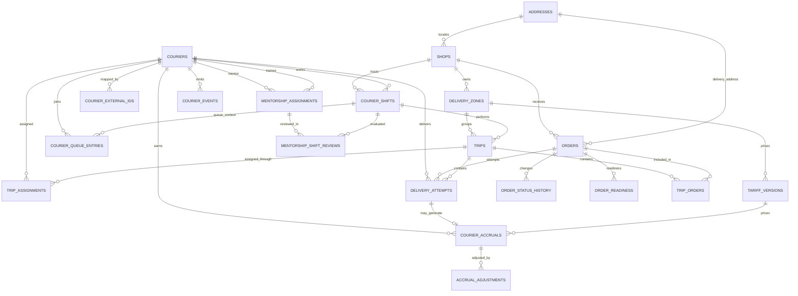

# Техническое задание для Claude Code
# Этап 1.5 — <ФИО>ирование собственной модели данных курьерской службы

**<ФИО>:** Courier Service  
**Этап:** 1.5 — логическая и физическая модель данных  
**Входной этап:** 1.4 — восстановление и аудит модели Superset  
**Рабочая директория:** `/c/soft/bun/dds`  
**Режим:** проектирование и локальные артефакты; без подключения к рабочим базам и без применения миграций  
**Версия:** 1.0

---

# 0. Главная задача

На основании результатов этапов 1.1–1.4 и согласованных ответов заказчика спроектировать собственную модель данных курьерской службы.

Результат этапа — не просто список таблиц. Необходимо подготовить проверенную модель, которая описывает:

1. ***REMOVED***ы и их жизненный цикл.
2. Торговые точки и адреса доставки.
3. Курьеров и их рабочее состояние.
4. Рабочие слоты, смены, очередь и доступность курьеров.
5. ***REMOVED*** доставки и правила их определения.
6. Ходки и входящие в них заказы.
7. Назначения заказов курьерам.
8. <ФИО> и историю действий.
9. Доставку, отмены и возвраты.
10. Начисления курьерам и основания расчёта.
11. Кураторов, наставничество и обучение новичков.
12. Источники данных Superset и сопоставление старых идентификаторов с новыми сущностями.

<ФИО> должна разделять данные, поступающие из существующих источников; данные, которые создаёт новая операционная система; справочники и правила, утверждаемые ответственными; вычисляемые показатели и отчёты.

**Главный принцип:** не переносить аналитическую структуру Superset в рабочую БД механически. Спроектировать операционную модель, отражающую реальные действия людей и системы.

# 1. ***REMOVED*** и результаты предыдущих этапов

## 1.1. Этап 1.4 закрыт

По отчёту пользователя:
- все контрольные точки G0–G7 имеют PASS;
- доступ к Superset восстановлен;
- каталог синхронизирован;
- расширенный поиск выполнен;
- подробно извлечены 62 datasets, 500 charts и 19 dashboards;
- разобрано 3 222 SQL;
- обнаружено 436 физических таблиц;
- построено 5 717 связей-кандидатов/SQL JOIN;
- создано 3 222 записи о зерне данных;
- PII в отчётах — 0;
- TypeScript проверен, 14 локальных тестов пройдены;
- `data/catalog.sqlite` не изменён;
- исходные БД не опрашивались SQL;
- Superset не изменялся;
- commit/push не выполнялись.

Основные отчёты Phase 1.4:
- `reports/phase-01-4/phase_01_4_summary.md`
- `reports/phase-01-4/final_validation.json`
- `reports/phase-01-4/06_modeling_report.md`
- `reports/phase-01-4/02_catalog_sync.md`
- `reports/phase-01-4/03_search_coverage.md`
- `reports/phase-01-4/05_sql_parsing_report.md`
- `reports/phase-01-4/07_quality_report.md`
- `reports/phase-01-4/07_business_coverage_matrix.csv`
- `reports/phase-01-4/07_quality_issues.csv`

Также использовать `06_physical_catalog.csv/json`, `06_logical_entities.csv/json`, `06_relationships.csv/json`, `06_data_grain_registry.csv/json`, `06_lineage.mmd`, `06_er_model.mmd`, `03_dataset_candidates.json`, SQL/table/column/metric inventories, extraction JSON и snapshots, если они доступны локально.

Сначала проверить фактическое наличие и содержимое файлов. Не полагаться только на это ТЗ или краткую сводку.

## 1.2. Известные ограничения источников

Не считать подтверждёнными следующие сведения:
- Событие `order_ready` отсутствует. `date_status_10` и `date_collected` — гипотезы, а не утверждённое событие готовности к выдаче курьеру.
- Подтверждённого справочника зон доставки нет.
- `area_tt` — территория торговой точки, а не доказанная зона доставки.
- `zone_cluster` — кластер, а не доказанная зона доставки.
- `inactivity_zone` / `zone` могут означать зоны неактивности.
- `sum_order` / `sum_paid` — суммы заказа/оплаты, не доход курьера.
- Тарифы курьеров не подтверждены.
- `events_qty` — количество событий, а не явка или количество смен.
- Полной модели смен нет.
- `shift_N_profit` и `shift_N_work_minutes` в dataset 7473 подтверждены только для первых пяти смен.
- Смысл `calculation_time + interval '3 hour'` в datasets 7006/7024/7027 не установлен.
- В dataset 7119 `1970-01-01` используется как sentinel отсутствующей даты.
- В dataset 5399 есть метрики с неразрешёнными колонками.
- В dataset 7473 есть метрики, ссылающиеся на отсутствующие поля.
- 39 SQL имеют неподдерживаемые конструкции.
- В отчёте качества есть эвристические unresolved references. Эвристическая связь не становится подтверждённой только потому, что попала в реестр.

Любое использование этих сведений в новой модели должно иметь статус доказательства и оговорку.

## 1.3. Источники данных, полезные для проектирования

| Dataset ID | Объект | Что может дать | ***REMOVED*** |
|---|---|---|---|
| 4732 | `darkstore_ts_partners_new` | ***REMOVED***ы, статусы, сборка, доставка, суммы | Суммы не являются оплатой курьера |
| 7006 | `cargo_main2` | Маршрутизация, расстояния, время, опоздания, пулы | Не считать автоматически операционной моделью ходок |
| 7024 | `cargo_main3` | Маршрутизация, план/факт | Проверять пересечения и различия с 7006 |
| 7027 | `cargo_main4` | Маршрутизация и флаги | Проверять семантику полей |
| 7119 | `cargo_flags` | Флаги и временные поля | Есть sentinel-дата |
| 5247 | `courier_logs_agg_couriers_daily` | <ФИО> курьеров по дням | <ФИО> не равны явке |
| 5399 | `courier_logs_agg_couriers_week` | <ФИО> курьеров по неделям | Есть проблемные метрики |
| 5797 | `hr_couriers` | HR-профиль курьеров | PII; значения не копировать в отчёты |
| 7465 | `hr_couriers_5shifts` | Показатели первых смен | Ограниченная модель первых смен |
| 7473 | `hr_couriers_five_shifts` | Аналитика первых пяти смен и оплаты | Поля/метрики имеют ограничения |
| 7775 | `all_couriers_list` | Список/состояние курьеров | PII; значения не копировать |
| 7293 | `hr_couriers_zone_balance` | Баланс миграции между зонами | Не доказывает наличие зон доставки |

Перед созданием любого mapping проверить конкретные поля и SQL в актуальных артефактах Phase 1.4. Не использовать таблицу выше как замену детальному аудиту.

# 2. Уже полученные бизнес-правила

<ФИО> ниже получены из двух раундов согласования. Сохранить их в отдельном реестре. Не превращать неоднозначное подтверждение в более конкретное правило.

## 2.1. ***REMOVED***ы и готовность

- MVP должен начинаться с общего списка заказов.
- Автоматическое распределение по зонам и автоматическая очередь не обязательны для самого первого запуска.
- Готовность заказа должна фиксироваться как отдельный факт/событие. Точный источник и ответственный за регистрацию требуют технического согласования.
- Готовность связывалась с завершением сборки/упаковки, но конкретный триггер должен быть закреплён в регламенте.
- Времена сборки и доставки уже утверждены заказчиком; получить документ/источник этих правил, не придумывать новые SLA.
- ***REMOVED***ы, отменённые или возвращённые, нельзя автоматически исключать из SLA: ответ на предложенное исключение был «Нет». Требуется отдельное правило обработки этих случаев.

## 2.2. ***REMOVED***

<ФИО> второго опросника:
- одна зона — одна торговая точка и территория вокруг неё;
- границы определяются сочетанием плотности заказов, расстояний и времени доставки;
- окончательные границы утверждает географический отдел;
- адрес на границе двух зон относится к зоне с минимальным временем доставки.

Ранее заказчик указывал на тепловую карту заказов, возможность предварительных границ и последующее уточнение. Необходимость хранить полную историю географических изменений оценивалась как непринципиальная. При этом система должна сохранять технический аудит изменений и даты действия правил, чтобы не терять объяснимость назначений.

**Не делать вывод**, что зоны уже существуют в Superset. Справочник зон доставки предстоит создать.

## 2.3. Ходки

- ***REMOVED*** — одна поездка курьера, содержащая несколько заказов.
- Целевой размер ходки — 3–5 заказов.
- Если готово только два заказа — курьер может выехать с двумя.
- Если готово больше пяти — выбор по сочетанию времени готовности, срочности и кратчайшего пути.
- Автоматическое формирование группы с возможностью ручной корректировки ранее было принято.
- ***REMOVED*** считается сформированной после создания её состава; назначение курьера — отдельное действие.
- После выезда состав ходки не меняется.
- Одна ходка содержит заказы только одной зоны.
- Изменение состава после назначения возможно до выезда, с записью истории.
- Ответственный за ручную корректировку в последнем опроснике — только куратор.

Уточнения:
- 3–5 — целевой диапазон, но не жёсткое ограничение БД: подтверждено исключение с двумя заказами.
- Не создавать CHECK `orders_count BETWEEN 3 AND 5`.
- Верхняя граница в пять заказов — правило формирования, но модель должна хранить фактический состав и причину исключения.
- Нельзя добавлять/удалять заказ после фиксации выезда, кроме отдельной корректирующей процедуры с явным правом и аудитом, если такой процесс позднее будет утверждён.

## 2.4. ***REMOVED*** курьеров

- Курьер может быть назначен только после прибытия на даркстор и отметки в очереди.
- При одновременном присутствии используется FIFO: кто раньше пришёл, тот раньше получает заказы.
- Если подошла очередь, но курьер не готов, его пропускают и переходят к следующему.
- Отказ от предложенной ходки не допускается.
- Время ожидания — до появления подходящих заказов, без установленного предельного лимита.
- Учитываются действия: начало смены, перерыв, возвращение, окончание смены.

Различать запись о прибытии, место в очереди, готовность принять ходку, временный пропуск, назначение, выезд и возврат в очередь после возвращения. ***REMOVED*** возвращения в очередь и сохранения/сброса приоритета пока не определено. Не придумывать.

## 2.5. Оплата

- Оплачивается каждый доставленный заказ.
- Оплата зависит от зоны и расстояния.
- Начисление происходит после доставки каждого заказа.
- Если в ходке один заказ отменён, оплачиваются только доставленные заказы.
- Простоя не должно быть; ожидание включено в стоимость заказа.
- Наказаний/штрафов нет.
- Оплата может меняться по мере загруженности курьеров, но формулу надбавки за загрузку не утвердили.
- Данные первых пяти смен используются как аналитический ориентир, не как подтверждённый универсальный тариф.

Не вычислять денежную сумму без утверждённого тарифа. <ФИО> должна поддерживать версионируемый тариф, тарифную зону, расстояние, тип заказа/доставки при необходимости и отдельную запись начисления по доставленному заказу. Денежные значения заказа из Superset не использовать как оплату курьера.

## 2.6. Кураторство и обучение

- Куратор и наставник — одна роль.
- Период сопровождения новичка — две недели.
- Куратор подтверждает успешное обучение.
- Качество оценивается по первым пяти сменам, качеству доставки и соблюдению правил.
- Куратор может добавлять заказы в ходку своей группы в пределах доступной нагрузки.
- В последнем опроснике указано «без ограничения» по количеству новичков на одного куратора. Сохранить ответ заказчика, но не превращать это в техническую бесконечную нагрузку: предусмотреть настраиваемое предупреждение, без блокирующего лимита до решения владельца процесса.
- Кто назначает новичка куратору, не выбран.
- После двух недель куратор подтверждает обучение; условия отрицательного результата/продления не определены.

## 2.7. Управление и права

- Автоматически сформированную ходку вручную меняет только куратор.
- Если заказ готов, но подходящего курьера нет, ответ не выбран.
- Для MVP ключевые показатели: ожидание курьера, время от готовности до доставки, доставки на курьера, соблюдение сроков.
- Критические изменения должны быть видны сразу; менее критичные аналитические показатели могут обновляться несколько раз в день.

# 3. Нерешённые бизнес-вопросы

Создать `business_decisions_register.csv/json`. Каждому вопросу присвоить ID, статус `OPEN`, владельца, влияние на модель и требуемое решение.

| ID | Вопрос | Почему важно |
|---|---|---|
| BD-001 | Кто назначает новичка куратору? | Назначение и права |
| BD-002 | Что делать, если заказ готов, но подходящего курьера нет? | ***REMOVED*** и исключения |
| BD-003 | Что считать подходящим курьером при отсутствии в своей зоне? | Допуск к назначению |
| BD-004 | Что делать при возврате курьера на даркстор: новый FIFO или сохранение приоритета? | ***REMOVED*** |
| BD-005 | Что происходит, если курьер не вернулся/не закрыл ходку? | Контроль незавершённых поездок |
| BD-006 | Как поступать с отменой после выезда? | История ходки и оплата |
| BD-007 | Как учитывать возврат после успешной доставки? | Корректировка начисления |
| BD-008 | Точная формула тарифа по зоне и расстоянию? | Расчёт оплаты |
| BD-009 | Как измеряется загруженность и влияет ли она на тариф? | Переменная часть оплаты |
| BD-010 | Когда начисление окончательно и кто подтверждает? | Финансовый статус |
| BD-011 | Какие роли, кроме куратора, могут отменить/переназначить ходку? | Доступы и аудит |
| BD-012 | Как фиксировать невозможность принять ходку, если отказ запрещён? | Исключительные ситуации |
| BD-013 | Кто и когда отмечает готовность заказа? | Событие `ORDER_READY` |
| BD-014 | Какие точные статусы и переходы заказа действуют? | Жизненный цикл |
| BD-015 | Как учитывать отменённые и возвращённые заказы в SLA? | Отчётность |
| BD-016 | Какой источник — мастер-источник заказа и его статуса? | Интеграция |
| BD-017 | Какой мастер-источник идентичности курьера и ТТ? | Сопоставление |
| BD-018 | Какая СУБД будет использоваться в production? | Физическая схема |
| BD-019 | Какой стек backend и механизм авторизации? | Реализация |
| BD-020 | Нужны ли слоты предварительного бронирования или только отметка прибытия? | Смены/очередь |
| BD-021 | Как обрабатывать неполную/частичную доставку? | Оплата и статусы |
| BD-022 | Нужно ли хранить историю геозон для воспроизведения назначений? | Аудит и аналитика |
| BD-023 | Какой срок хранения событий и финансовых записей? | Архивирование |
| BD-024 | Кто утверждает тарифы и с какой даты они действуют? | Управление тарифами |

Claude Code не должен блокировать логическую модель из-за этих вопросов. Помечать зависимые поля/правила как `TBD`, не подставлять выдуманные значения, предложить безопасные варианты и указать последствия.

# 4. Архитектурные требования

## 4.1. Разделение контуров

**Операционный контур:** заказы, торговые точки, адреса, зоны, готовность, ходки, состав ходок, очередь, курьеры, смены, назначения, доставка, события.

**Финансовый контур:** тарифы, версии тарифов, основания начисления, начисления по заказам, корректировки, финансовые статусы, аудит расчёта.

**HR/обучение:** профиль курьера, статус занятости, назначение куратора, период обучения, первые пять смен, результаты оценки, завершение/продление обучения.

Операционный контур не должен зависеть от HR-аналитических таблиц Superset в момент назначения курьера. Для назначения нужна локальная актуальная запись о допуске и доступности курьера.

## 4.2. Источники и собственность данных

Для каждого атрибута определить owner/source of truth, кто создаёт, кто обновляет, разрешено ли ручное изменение, частоту синхронизации, историю изменений и уровень доверия.

Разделить `external_id`, внутренний PK, `source_system`, `source_object_id`, `source_updated_at`, `synced_at`. Не использовать внешний ID как единственный PK без доказательства его стабильности и уникальности.

## 4.3. Общие правила хранения

- PK — внутренние устойчивые идентификаторы.
- FK — только реальные отношения новой модели, а не найденные SQL JOIN.
- Время хранить в UTC; отображать в `Europe/Moscow`, если заказчик подтвердит его как операционный часовой пояс. Историческая поправка `+3 hour` не основание прибавлять три часа ко всем датам.
- Деньги — `DECIMAL/NUMERIC` с валютой, не `FLOAT`.
- Расстояния хранить с единицами измерения и источником расчёта.
- Не хранить вычисляемые KPI как независимую истину, если они вычисляются из событий.
- Для критичных изменений — append-only audit/event trail.
- Для изменяемых справочников — `valid_from`, `valid_to`, `is_active`, `created_at`, `updated_at`.
- Физическое удаление операционных/финансовых записей не применять; использовать статусы/архивирование и аудит.
- Любое изменение состава ходки до выезда записывать в историю.
- После выезда состав ходки неизменяем.
- PII не помещать в логи и отчёты разработчика.

# 5. Предлагаемая логическая модель и таблицы

<ФИО> целевая логическая модель для проектирования, а не утверждение, что все сущности уже присутствуют в источниках. Claude Code должен проверить зерно, кардинальности, обязательность полей и возможное объединение/разделение сущностей.

## 5.1. Справочники и идентичность

### `shops` — торговые точки / дарксторы
- `id` PK;
- `external_source_id` nullable;
- `code` unique;
- `name`;
- `address_id` FK;
- `timezone` nullable;
- `status` (`ACTIVE`, `INACTIVE`);
- `valid_from`, `valid_to`;
- `created_at`, `updated_at`.

### `addresses` — адреса
- `id` PK;
- `country_code`, `region`, `city`, `street`, `house`;
- `building`, `apartment`, `postal_code` nullable;
- `latitude`, `longitude` nullable;
- `geocode_source`, `geocode_confidence`, `normalized_hash` nullable;
- `created_at`, `updated_at`.

Координаты могут отсутствовать; адрес не терять при ошибке геокодирования. Нормализация не должна объединять разные квартиры/корпуса. Для адресов определить PII-политику.

### `couriers` — курьеры
- `id` PK;
- `external_hr_id`, `external_user_id` nullable;
- `display_name` с ограниченным доступом;
- `courier_type`, `employment_type` nullable;
- `operational_status` (`ACTIVE`, `SUSPENDED`, `INACTIVE`, `PENDING`);
- `is_blocked`;
- `hired_at`, `terminated_at` nullable;
- `created_at`, `updated_at`.

Не копировать HR-паспортные данные, телефоны и другие чувствительные атрибуты без необходимости. Для авторизации использовать отдельный identity/user mapping, если нужен.

### `courier_external_ids` — сопоставление внешних идентификаторов
- `id` PK;
- `courier_id` FK;
- `source_system`;
- `external_id`;
- `valid_from`, `valid_to`;
- `created_at`.

Уникальность `(source_system, external_id)` для непересекающихся периодов действия. Если СУБД не поддерживает exclusion constraints, реализовать транзакционную проверку.

## 5.2. География

### `delivery_zones` — зоны доставки
- `id` PK;
- `shop_id` FK;
- `code` unique;
- `name`;
- `boundary_type` (`POLYGON`, `RADIUS`, `MANUAL`, `UNDEFINED`);
- `boundary_geometry` nullable;
- `status` (`DRAFT`, `ACTIVE`, `INACTIVE`);
- `approved_by`, `approved_at` nullable;
- `valid_from`, `valid_to`;
- `created_at`, `updated_at`.

Активная зона принадлежит одной торговой точке и должна быть утверждена географическим отделом. Геометрия может быть GeoJSON или пространственным типом — выбрать после определения СУБД.

### `zone_boundary_versions` — версии границ зон
- `id` PK;
- `zone_id` FK;
- `version`;
- `boundary_geometry`;
- `change_reason`;
- `created_by`, `approved_by`;
- `valid_from`, `valid_to`;
- `created_at`.

История изменений ранее называлась непринципиальной заказчику, но версия границы полезна для воспроизводимости. Оформить как техническую рекомендацию и отметить необходимость подтверждения включения в MVP.

## 5.3. ***REMOVED***ы и готовность

### `orders` — заказы
- `id` PK;
- `external_order_id`;
- `source_system`;
- `shop_id` FK;
- `delivery_address_id` FK;
- `customer_reference` nullable (псевдоним/внешняя ссылка, не ФИО);
- `order_status`;
- `priority` nullable;
- `order_created_at`;
- `accepted_at`, `collection_started_at`, `collected_at`, `ready_at` nullable;
- `delivery_started_at`, `delivered_at`, `cancelled_at`, `returned_at` nullable;
- `sla_due_at`, `source_updated_at` nullable;
- `created_at`, `updated_at`.

Уникальность `(source_system, external_order_id)`. Не заполнять `ready_at` из `date_status_10` или `date_collected` автоматически. До подтверждения источника `ready_at` может быть NULL.

Если суммы заказа нужны для аналитики, вынести их в `order_amount_snapshots` или отдельную сущность с валютой и источником. Не использовать для расчёта оплаты курьера.

### `order_status_history` — история статусов
- `id` PK;
- `order_id` FK;
- `from_status` nullable;
- `to_status`;
- `changed_at`;
- `changed_by_type`, `changed_by_id` nullable;
- `source_system`;
- `source_event_id` nullable;
- `reason` nullable.

Append-only.

### `order_readiness` — факт готовности
- `id` PK;
- `order_id` FK;
- `ready_at`;
- `ready_source`;
- `ready_actor_type`, `ready_actor_id` nullable;
- `confirmation_status` (`CONFIRMED`, `REVOKED`, `DISPUTED`);
- `created_at`.

Для первой версии можно обеспечить одну активную запись готовности на заказ. Если возможны повторные циклы сборки, использовать readiness attempts с номером попытки. <ФИО> сценарий и зафиксировать ADR.

## 5.4. Слоты, смены и очередь

### `work_slots` — рабочие слоты
- `id` PK;
- `shop_id` FK;
- `starts_at`, `ends_at`;
- `capacity` nullable;
- `status` (`OPEN`, `CLOSED`, `CANCELLED`);
- `created_at`, `updated_at`.

Бронирование слотов пока не подтверждено. Сущность опциональна; обязательный workflow бронирования не внедрять без решения BD-020.

### `courier_shifts` — смены
- `id` PK;
- `courier_id` FK;
- `shop_id` FK;
- `work_slot_id` FK nullable;
- `planned_start_at`, `planned_end_at` nullable;
- `actual_start_at`, `actual_end_at` nullable;
- `shift_status` (`PLANNED`, `STARTED`, `ON_BREAK`, `AVAILABLE`, `COMPLETED`, `NO_SHOW`, `CANCELLED`);
- `created_at`, `updated_at`.

***REMOVED*** — интервал фактической работы с началом и окончанием. Не выводить смены из `events_qty`.

### `courier_queue_entries` — очередь курьеров
- `id` PK;
- `courier_id` FK;
- `shop_id` FK;
- `shift_id` FK;
- `arrived_at`;
- `queue_sequence` — монотонный номер в пределах магазина/очереди;
- `queue_status` (`WAITING`, `SKIPPED`, `OFFERED`, `ASSIGNED`, `PAUSED`, `LEFT`, `CLOSED`);
- `ready_for_assignment_at`, `skipped_at`, `closed_at` nullable;
- `skip_reason` nullable;
- `created_at`, `updated_at`.

FIFO определяется по `queue_sequence`. Возвращение пропущенного курьера в очередь требует решения о приоритете.

## 5.5. Ходки и назначения

### `trips` — ходки
- `id` PK;
- `shop_id` FK;
- `zone_id` FK;
- `courier_id` FK nullable до назначения;
- `shift_id` FK nullable;
- `trip_number` nullable;
- `trip_status` (`DRAFT`, `FORMED`, `ASSIGNED`, `DEPARTED`, `IN_PROGRESS`, `RETURNED`, `COMPLETED`, `CANCELLED`, `EXCEPTION`);
- `formed_at`;
- `assigned_at`, `departed_at`, `returned_at`, `completed_at` nullable;
- `created_by`;
- `created_at`, `updated_at`.

Одна ходка принадлежит одной зоне и одному даркстору. До назначения курьера `courier_id` может быть NULL.

### `trip_orders` — состав ходки
- `id` PK;
- `trip_id` FK;
- `order_id` FK;
- `sequence_no`;
- `added_at`, `added_by`;
- `removed_at`, `removed_by`, `removal_reason` nullable;
- `created_at`.

Ограничения:
- заказ не может одновременно входить в две активные ходки;
- активная строка состава уникальна по `order_id`;
- один заказ в ходке встречается один раз;
- `sequence_no` уникален внутри ходки;
- все заказы одной ходки должны относиться к той же зоне/ТТ по утверждённому mapping;
- после `DEPARTED` изменение состава запрещено;
- до `DEPARTED` изменение только куратором и с аудитом;
- количество заказов не ограничивать диапазоном 3–5 на уровне БД; проверять бизнес-правило и сохранять причину отклонения.

Для истории использовать append-only события или `trip_order_membership_history`, не удалять состав физически.

### `trip_assignments` — назначения курьеров
- `id` PK;
- `trip_id` FK;
- `courier_id` FK;
- `queue_entry_id` FK nullable;
- `assigned_at`, `assigned_by`;
- `assignment_status` (`PROPOSED`, `ACCEPTED`, `CANCELLED`, `DEPARTED`, `COMPLETED`);
- `cancelled_at`, `cancel_reason` nullable.

Запрет отказа в обычном процессе не означает, что администратор никогда не сможет отменить ошибочное назначение. Аварийные отмены — отдельные права и обязательная причина.

## 5.6. Доставка и события

### `delivery_attempts` — попытки доставки
- `id` PK;
- `order_id` FK;
- `trip_id` FK;
- `courier_id` FK;
- `attempt_no`;
- `started_at`;
- `completed_at` nullable;
- `result` (`DELIVERED`, `FAILED`, `CANCELLED`, `RETURNED`, `PARTIAL`, `UNKNOWN`);
- `failure_reason`, `proof_reference` nullable;
- `created_at`.

Уникальность `(order_id, attempt_no)`. Повторная попытка не перезаписывает предыдущую.

### `courier_events` — события курьера
- `id` PK;
- `courier_id` FK;
- `shift_id`, `shop_id` FK nullable;
- `event_type`;
- `occurred_at`, `recorded_at`;
- `actor_type`, `actor_id` nullable;
- `source_system`, `source_event_id` nullable;
- `payload` JSON;
- `idempotency_key`;
- `created_at`.

### `domain_events` — общий журнал событий
- `id` PK;
- `aggregate_type`, `aggregate_id`;
- `event_type`, `event_version`;
- `occurred_at`, `recorded_at`;
- `actor_type`, `actor_id` nullable;
- `source_system`, `source_event_id` nullable;
- `correlation_id`, `causation_id` nullable;
- `idempotency_key`;
- `payload` JSON;
- `schema_version`;
- `created_at`.

Журнал append-only. Не хранить секреты и лишние персональные данные в payload. Не дублировать большие payload в нескольких журналах без обоснования.

## 5.7. Финансовая модель

### `tariff_versions` — версии тарифов
- `id` PK;
- `name`;
- `zone_id`, `shop_id` FK nullable;
- `distance_from_m`, `distance_to_m` nullable;
- `order_type` nullable;
- `base_amount` NUMERIC;
- `currency`;
- `effective_from`, `effective_to` nullable;
- `approved_by`, `approved_at`;
- `status` (`DRAFT`, `APPROVED`, `ACTIVE`, `RETIRED`);
- `created_at`.

Не создавать действующие тарифные строки с придуманными суммами. Пока тарифы не утверждены — только структура и синтетические fixtures с явной пометкой.

### `courier_accruals` — начисления
- `id` PK;
- `courier_id`, `order_id`, `delivery_attempt_id`, `trip_id` FK;
- `tariff_version_id` FK nullable;
- `calculation_basis` JSON;
- `amount` NUMERIC;
- `currency`;
- `accrual_status` (`PENDING`, `APPROVED`, `REVERSED`, `PAID`, `ON_HOLD`);
- `earned_at`;
- `approved_at`, `paid_at` nullable;
- `created_at`, `updated_at`.

Начисление за доставленный заказ. Недоставленный заказ не получает обычного положительного начисления. Возврат после доставки и корректировка — отдельный сценарий с бизнес-решением.

### `accrual_adjustments` — корректировки
- `id` PK;
- `accrual_id` FK;
- `adjustment_type` (`REVERSAL`, `CORRECTION`, `MANUAL_ADJUSTMENT`);
- `amount_delta` NUMERIC;
- `reason`;
- `approved_by`;
- `created_at`.

Не менять исходное начисление задним числом; корректировать отдельной записью. Запрет штрафов означает, что санкционные начисления не реализуются. Возврат ошибочного начисления — отдельная бухгалтерская операция, не штраф.

## 5.8. Обучение

### `mentorship_assignments` — назначение куратора
- `id` PK;
- `mentor_courier_id` FK → couriers;
- `trainee_courier_id` FK → couriers;
- `assigned_by` nullable;
- `starts_at`, `planned_ends_at`;
- `actual_ends_at` nullable;
- `status` (`ACTIVE`, `COMPLETED`, `EXTENDED`, `CANCELLED`);
- `completion_confirmed_by`, `completion_confirmed_at` nullable;
- `created_at`, `updated_at`.

Куратор и наставник — одна роль. Не создавать две сущности без подтверждённого различия.

### `mentorship_shift_reviews` — оценка обучения
- `id` PK;
- `mentorship_assignment_id` FK;
- `shift_id` FK;
- `shift_number`;
- `delivery_quality_score`, `rules_compliance_score` nullable;
- `review_comment` nullable;
- `reviewed_by`, `reviewed_at`.

Первые пять смен — ориентир оценки, не ограничение числа смен. Шкала и формула успеха требуют согласования.

## 5.9. Пользователи и роли

Если авторизация уже реализована — переиспользовать её и не создавать второй механизм. Если её нет — описать интерфейс модели, но не внедрять пароли и собственную авторизацию в рамках этапа 1.5 без решения архитектуры.

Минимальные роли для проектирования: `ADMIN`, `OPERATIONS_MANAGER`, `GEO_MANAGER`, `CURATOR`, `DISPATCHER` (если утверждён), `COURIER`, `HR`, `FINANCE`, `READ_ONLY_ANALYST`.

Роль `DISPATCHER` не получает право менять состав ходки, пока действует ответ «только куратор».

# 6. ER-диаграмма

Создать Mermaid ER diagram в `docs/phase-01-5/06_er_model.mmd`. Базовую диаграмму ниже уточнить после аудита и проверки кардинальностей.



Требования:
- Mermaid должен быть валиден и рендериться.
- Для каждой таблицы перечислить PK, FK, unique constraints и индексы.
- Отдельно показать необязательные связи.
- Не показывать SQL JOIN из Superset как FK без доказательства.
- Создать диаграмму событийного потока заказа/ходки/курьера.
- Создать диаграмму финансового процесса начисления.
- Mermaid source обязателен; PNG/SVG только если в проекте уже есть renderer.

# 7. Жизненные циклы

## 7.1. ***REMOVED***

<ФИО> состояния: `RECEIVED`, `ACCEPTED`, `COLLECTING`, `COLLECTED`, `READY`, `ASSIGNED`, `IN_DELIVERY`, `DELIVERED`, `CANCELLED`, `RETURNED`, `EXCEPTION`.

<ФИО> проектный перечень. Сопоставить его с реальными статусами источников и согласованным процессом. Не объявлять неподтверждённые переходы утверждёнными.

- `READY` устанавливается только подтверждённым событием готовности.
- `ASSIGNED` означает, что заказ включён в назначенную ходку.
- `IN_DELIVERY` начинается после фактического выезда/старта доставки.
- `DELIVERED` фиксируется фактом успешной доставки.
- `CANCELLED` и `RETURNED` не стирают историю.
- Переходы валидируются серверной бизнес-логикой, не только UI.

## 7.2. ***REMOVED***

<ФИО>: `DRAFT → FORMED → ASSIGNED → DEPARTED → IN_PROGRESS → RETURNED/COMPLETED`; дополнительные `CANCELLED`, `EXCEPTION`.

- `FORMED`: состав зафиксирован как сформированный.
- `ASSIGNED`: курьер назначен.
- `DEPARTED`: записано время выезда; состав блокируется.
- `RETURNED`: курьер вернулся на даркстор.
- `COMPLETED`: ходка закрыта по утверждённым правилам.
- `EXCEPTION`: проблемный сценарий с обязательной причиной.

Не предполагать, что `RETURNED` автоматически означает завершение всех доставок.

## 7.3. ***REMOVED***

<ФИО> записи: `WAITING`, `SKIPPED`, `OFFERED`, `ASSIGNED`, `PAUSED`, `LEFT`, `CLOSED`.

Каждому входу присваивается `queue_sequence`; последовательность создаётся транзакционно; два одновременных входа не получают одинаковый номер; пропуск не удаляет запись. Возврат пропущенного курьера требует решения о новом месте.

## 7.4. ***REMOVED***

<ФИО>: `SHIFT_STARTED`, `BREAK_STARTED`, `BREAK_ENDED`, `COURIER_RETURNED_TO_SHOP`, `SHIFT_ENDED`, `NO_SHOW_RECORDED`.

***REMOVED*** не выводится из факта доставки или количества событий. Начало и окончание хранятся отдельно.

# 8. Каталог событий

Создать `docs/phase-01-5/10_event_catalog.md` и машинный реестр `11_event_catalog.json`.

Обязательные поля события: `event_id`, `event_type`, `aggregate_type`, `aggregate_id`, `occurred_at`, `recorded_at`, `actor_type`, `actor_id`, `source_system`, `source_event_id`, `correlation_id`, `causation_id`, `idempotency_key`, `schema_version`, `payload`.

## 8.1. <ФИО> заказов

- `ORDER_IMPORTED` — заказ загружен из внешней системы.
- `ORDER_ACCEPTED` — заказ принят в процесс.
- `COLLECTION_STARTED` — начата сборка.
- `COLLECTION_COMPLETED` — сборка завершена.
- `ORDER_READY` — заказ официально готов к передаче курьеру; обязательны `order_id`, `ready_at`, источник/ответственный.
- `ORDER_ASSIGNED_TO_TRIP` — заказ включён в ходку.
- `ORDER_REMOVED_FROM_TRIP` — заказ исключён до выезда, причина обязательна.
- `ORDER_DELIVERY_STARTED` — началась доставка.
- `ORDER_DELIVERED` — доставка завершена успешно.
- `ORDER_CANCELLED` — заказ отменён.
- `ORDER_RETURNED` — заказ возвращён.
- `ORDER_STATUS_CORRECTED` — исправлен ошибочный статус с причиной и автором.

`ORDER_READY` — новое критическое событие, не подтверждённое в Superset. Не подменять его аналитическим timestamp без согласования.

## 8.2. <ФИО> зон

`ZONE_CREATED`, `ZONE_BOUNDARY_PROPOSED`, `ZONE_BOUNDARY_APPROVED`, `ZONE_ACTIVATED`, `ZONE_DEACTIVATED`, `ZONE_BOUNDARY_CHANGED`.

Payload содержит `zone_id`, версию, ссылку на геометрию, автора и утверждающего.

## 8.3. <ФИО> курьеров и смен

`COURIER_REGISTERED`, `COURIER_STATUS_CHANGED`, `SHIFT_PLANNED`, `SHIFT_STARTED`, `COURIER_ARRIVED_AT_SHOP`, `COURIER_JOINED_QUEUE`, `COURIER_SKIPPED_IN_QUEUE`, `COURIER_QUEUE_PAUSED`, `COURIER_QUEUE_RESUMED`, `BREAK_STARTED`, `BREAK_ENDED`, `COURIER_RETURNED_TO_SHOP`, `SHIFT_ENDED`, `COURIER_BLOCKED`, `COURIER_UNBLOCKED`.

## 8.4. <ФИО> ходок и назначений

`TRIP_FORMED`, `TRIP_ORDER_ADDED`, `TRIP_ORDER_REMOVED`, `TRIP_ASSIGNED`, `TRIP_ASSIGNMENT_CANCELLED`, `TRIP_DEPARTED`, `TRIP_RETURNED`, `TRIP_COMPLETED`, `TRIP_CANCELLED`, `TRIP_EXCEPTION_RECORDED`.

`TRIP_ORDER_ADDED/REMOVED` запрещены после `TRIP_DEPARTED` в обычном процессе. Коррекции задним числом — только отдельная административная процедура с аудитом и отдельным решением заказчика.

## 8.5. Финансовые события

`TARIFF_DRAFTED`, `TARIFF_APPROVED`, `TARIFF_ACTIVATED`, `COURIER_ACCRUAL_CREATED`, `COURIER_ACCRUAL_APPROVED`, `COURIER_ACCRUAL_REVERSED`, `COURIER_ACCRUAL_PAID`, `ACCRUAL_ADJUSTED`.

Начисление создаётся после подтверждённого `ORDER_DELIVERED`, не от суммы заказа.

## 8.6. <ФИО> обучения

`MENTORSHIP_ASSIGNED`, `MENTORSHIP_STARTED`, `MENTORSHIP_SHIFT_REVIEWED`, `MENTORSHIP_COMPLETED`, `MENTORSHIP_EXTENDED`, `MENTORSHIP_CANCELLED`.

Двухнедельный срок хранить как плановую дату окончания. Фактическое завершение фиксировать отдельным событием.

# 9. Правила целостности и инварианты

Формализовать в `12_integrity_rules.md`; проверяемые правила покрыть тестами.

## 9.1. ***REMOVED***ы

1. Внешний заказ уникален по `(source_system, external_order_id)`.
2. У заказа есть торговая точка и адрес доставки, если это обязательные поля мастер-источника.
3. `delivered_at` не раньше `order_created_at`.
4. `ready_at` не раньше начала/окончания сборки без явного исключения.
5. Статус `DELIVERED` требует подтверждённого события доставки.
6. Отмена не удаляет заказ из истории.
7. Изменение статуса имеет источник и время.

## 9.2. ***REMOVED***

1. Активная зона принадлежит одной торговой точке.
2. Активная зона утверждена географическим отделом.
3. У заказа можно хранить `assigned_zone_id` как результат определения зоны на момент назначения.
4. Изменение текущих границ не переписывает зону уже сформированной ходки.
5. Адрес на границе относится к зоне с минимальным временем доставки.
6. Если расчёт времени невозможен или конфликтен, автоматическое назначение зоны не выполняется молча — создаётся исключение для ответственного.

## 9.3. Ходки

1. Все активные заказы ходки принадлежат одной зоне и одному даркстору.
2. Один заказ входит только в одну активную ходку.
3. Один курьер не имеет две активные ходки одновременно, если многозадачный режим отдельно не утверждён.
4. Состав после выезда неизменяем.
5. Состав до выезда меняет только куратор.
6. Каждое изменение имеет автора, время и причину.
7. `sequence_no` уникален внутри ходки.
8. ***REMOVED*** с двумя заказами допустима.
9. При превышении пяти заказов система объясняет нарушение правила; автоматическое добавление шестого заказа запрещено без специального разрешения.

## 9.4. ***REMOVED***

1. FIFO определяется монотонной последовательностью в пределах магазина/очереди.
2. В очередь можно попасть только после отметки прибытия.
3. Курьер с неактивной/завершённой сменой не получает назначение.
4. Пропуск не стирает историю.
5. Повторный вход не создаёт дубликат активной очереди для той же смены.
6. ***REMOVED*** возврата пропущенного курьера требует отдельного решения.

## 9.5. Смены

1. ***REMOVED*** принадлежит одному курьеру и одному даркстору.
2. `actual_end_at >= actual_start_at`.
3. Нельзя завершить смену при незакрытой ходке без явной процедуры исключения.
4. Перерывы не пересекаются.
5. Продолжительность смены вычисляется из событий/интервалов, не из `events_qty`.

## 9.6. Оплата

1. Начисление связано с конкретным доставленным заказом и попыткой доставки.
2. Идемпотентность не допускает повторного начисления за одну доставку.
3. Начисление хранит использованную версию тарифа и параметры расчёта.
4. Сумма — NUMERIC/DECIMAL, валюта обязательна.
5. Историческое начисление не пересчитывается при изменении тарифа.
6. Корректировки — отдельные записи.
7. Не начислять стандартную оплату за отменённый/недоставленный заказ.
8. Не создавать штрафы/санкции.
9. Не использовать `sum_paid` как сумму начисления курьеру.

## 9.7. Обучение

1. Наставник и новичок — разные курьеры.
2. Одно активное назначение наставника для новичка, если совместная схема не утверждена.
3. Плановый срок — две недели.
4. Завершение имеет подтверждающего и дату.
5. Отсутствие оценки не равно успешному обучению.
6. Не ограничивать количество учеников жёстким CHECK; предусмотреть настраиваемое предупреждение.

## 9.8. <ФИО>

1. <ФИО> append-only.
2. `idempotency_key` уникален в пределах источника/типа по выбранной стратегии.
3. `occurred_at` и `recorded_at` — разные поля.
4. Повторная доставка события не повторяет бизнес-эффект.
5. Поздние события сохраняют фактическое время и время приёма.
6. Ошибочные события не удаляются — создаётся компенсирующее/корректирующее событие.
7. Версия схемы payload обязательна.
8. Payload валидируется по JSON Schema/типам события.

# 10. Транзакции и конкурентный доступ

## 10.1. Формирование ходки

<ФИО>: выбрать готовые и не назначенные заказы одной зоны; проверить отсутствие активной ходки; создать `trips`; создать `trip_orders`; записать `TRIP_FORMED` и события добавления; зафиксировать операцию.

Если два пользователя одновременно формируют ходки, заказ не может попасть в обе.

## 10.2. Назначение курьера

<ФИО>: проверить активную смену; проверить очередь; проверить доступность и отсутствие активной ходки; создать `trip_assignments`; обновить ходку; обновить очередь; записать события.

Использовать блокировки строк, optimistic concurrency или иной механизм выбранной СУБД. Описать выбор.

## 10.3. ***REMOVED***

<ФИО> проверить назначение и состав, зафиксировать `departed_at`, перевести ходку в `DEPARTED`, запретить обычные изменения `trip_orders`, записать событие.

## 10.4. Успешная доставка и начисление

<ФИО> или через transactional outbox:
1. записать `ORDER_DELIVERED`;
2. завершить попытку доставки;
3. перевести заказ в доставленный статус;
4. определить действовавшую версию тарифа;
5. создать одно начисление;
6. записать событие начисления.

Если расчёт тарифа временно невозможен, доставка всё равно фиксируется; начисление получает статус ожидания/ошибки расчёта, а не теряется.

# 11. Миграции и версионирование схемы

Этап 1.5 — проектирование. Реальные миграции не применять к рабочим системам.

## 11.1. Сначала определить СУБД

В репозитории есть Bun + TypeScript и локальная SQLite для каталога аналитики. <ФИО> не доказывает, что SQLite подходит для production операционной системы.

Claude Code должен проверить текущую конфигурацию и ADR, выяснить, существует ли production DB; если решения нет — сравнить PostgreSQL и SQLite с учётом конкурентной очереди, транзакций, геоданных, событий, JSON и эксплуатации; дать рекомендацию; зафиксировать `ADR-001-database-choice.md`; не создавать окончательные DDL до утверждения СУБД.

Рекомендация для обсуждения: PostgreSQL для многопользовательской операционной системы; SQLite допустима для локального прототипа/однопользовательского режима. <ФИО> рекомендация, не принятое решение.

## 11.2. Предварительный план миграций

- `0001_core_reference` — магазины, адреса, курьеры, внешние ID.
- `0002_orders` — заказы, статусы, история, готовность.
- `0003_geo_zones` — зоны и версии границ.
- `0004_shifts_queue` — слоты (если утверждены), смены, очередь.
- `0005_trips_assignments` — ходки, состав, назначения.
- `0006_delivery_events` — попытки доставки и события.
- `0007_tariffs_accruals` — тарифы, начисления, корректировки.
- `0008_mentorship` — кураторство и оценки.
- `0009_access_audit` — роли/права, если auth не переиспользуется.
- `0010_indexes_constraints` — дополнительные индексы, уникальности, ограничения.

Последовательность уточнить после ER. Для каждой миграции указать цель, DDL draft, зависимости, эффект, обратимость, rollback, проверку до/после, риск блокировок и влияние на данные.

## 11.3. Безопасная стратегия миграций

- Expand → backfill → validate → switch → contract.
- Сначала nullable columns/новые таблицы.
- Backfill только из разрешённых источников и после отдельного разрешения.
- Не удалять старые поля/таблицы на этом этапе.
- Не менять исходные таблицы Superset.
- Не мигрировать PII без основания.
- Сверять counts, уникальность и orphan FKs.
- Все миграции имеют номер и checksum.
- Повторный запуск безопасен или корректно отклоняется.
- Rollback не теряет операционные события/финансовую историю.
- Для финансовых данных предпочитать компенсирующие операции вместо destructive rollback.

# 12. Интеграция с Superset и mapping

Создать `superset-to-domain-mapping.csv/json`.

Для каждой логической сущности/атрибута указать новую сущность, новое поле, источник Superset (dataset ID, таблица, поле), SQL reference, тип доказательства (`DIRECT`, `DERIVED`, `INFERRED`, `UNKNOWN`), confidence, ограничения, пригодность для первоначальной загрузки, необходимость нового события/справочника и владельца подтверждения.

Принципы:
- Superset — read-only аналитический источник.
- Новая операционная БД — владелец новых операционных фактов.
- Исторические аналитические поля не становятся автоматически источником истины.
- Внешние ключи не создавать только по совпадающим именам.
- Для mapping различать историческое и новое операционное значение.

Отдельно создать `source_of_truth_matrix.csv`, `external_id_mapping.md`, `data_migration_candidates.csv`.

# 13. Безопасность, PII и доступы

- Минимизация персональных данных.
- Доступ по ролям и принципу минимальных привилегий.
- Адрес доставки виден только необходимым ролям.
- HR-поля отделены от операционных.
- Финансовые начисления доступны только уполномоченным ролям.
- Действия куратора и руководителя аудируются.
- Секреты не попадают в логи.
- PII не попадает в fixtures, тестовые отчёты и примеры.
- Использовать синтетические данные.
- Политику хранения/удаления PII оформить отдельным решением.
- Экспорт учитывать роль пользователя.

Не создавать собственную систему хранения паролей, если в проекте уже есть identity provider/auth.

# 14. Обязательные артефакты

Создать каталог `docs/phase-01-5/`:

```text
docs/phase-01-5/
  README.md
  00_scope_and_assumptions.md
  repository_audit.md
  01_business_rules_register.md
  02_business_decisions_register.md
  business_decisions_register.csv
  business_decisions_register.json
  03_domain_glossary.md
  04_logical_data_model.md
  05_physical_data_model.md
  06_er_model.mmd
  07_order_lifecycle.mmd
  08_trip_and_queue_lifecycle.mmd
  09_financial_flow.mmd
  10_event_catalog.md
  11_event_catalog.json
  12_integrity_rules.md
  13_indexes_and_constraints.md
  14_superset_mapping.md
  superset-to-domain-mapping.csv
  superset-to-domain-mapping.json
  15_source_of_truth_matrix.csv
  16_external_id_mapping.csv
  17_migration_plan.md
  18_migration_matrix.csv
  19_security_and_pii.md
  20_open_questions.md
  21_adr/
  validation/
    model_validation.json
    model_validation.md
    schema_lint.json
    coverage_matrix.csv
```

Также подготовить Mermaid ER, sequence/state diagrams, JSON Schema для ключевых событий, DDL draft для выбранной/предполагаемой СУБД с пометкой DRAFT, синтетические fixtures и словарь терминов на русском языке.

Если в проекте уже есть принятая структура документации, встроить результаты в неё, не создавать параллельную документацию.

# 15. Автоматические проверки

## 15.1. Структурные

- У каждой таблицы есть PK.
- Все FK ссылаются на существующие таблицы/поля.
- Типы FK совместимы с PK.
- Unique constraints не конфликтуют.
- Nullable/not-null согласованы с правилами.
- Индексы покрывают ключевые операции.
- Статусы и переходы описаны.
- Миграции имеют последовательные номера.
- Mermaid диаграммы синтаксически корректны.
- JSON Schema событий валидна.

## 15.2. <ФИО>-проверки

- Нельзя добавить заказ в две активные ходки.
- Нельзя добавить заказ из другой зоны в ходку.
- Нельзя изменить состав после выезда.
- Нельзя назначить курьера без активной смены/допустимого состояния.
- FIFO не нарушается при одновременном входе.
- Пропуск не стирает историю.
- ***REMOVED*** нельзя считать готовым без подтверждённого события.
- Начисление нельзя создать повторно.
- Недоставленный заказ не получает обычное положительное начисление.
- Тариф должен действовать на момент доставки.
- Корректировка не изменяет исходное начисление.
- Куратор не редактирует завершённую ходку без отдельного права.
- Наставник не может быть тем же курьером, что и новичок.

## 15.3. Минимальные тестовые сценарии

1. Импорт нового заказа.
2. Повторный импорт того же заказа — без дубля.
3. Сборка и событие готовности.
4. Формирование ходки из трёх заказов.
5. Формирование ходки из двух заказов — допустимо.
6. Попытка включить заказ другой зоны — отказ.
7. Два параллельных формирования — заказ только в одной ходке.
8. FIFO двух курьеров.
9. Пропуск неготового курьера.
10. Назначение курьера.
11. Попытка изменить состав после выезда — отказ.
12. Успешная доставка и одно начисление.
13. Повтор события доставки — без повторного начисления.
14. Отмена одного заказа в многозаказной ходке — остальные доставки не затрагиваются.
15. Отмена до доставки — нет обычного начисления.
16. Неутверждённый тариф — доставка фиксируется, начисление ожидает тарифа.
17. Корректировка начисления — исходная запись сохранена.
18. Начало и окончание смены.
19. Перерыв и возвращение.
20. Назначение наставника и завершение двухнедельного периода.
21. Отсутствие обязательного решения BD — система не подставляет выдуманное значение.
22. Нет PII в тестовых fixtures.

# 16. Границы этапа и запреты

Разрешено читать исходники и отчёты; создавать документацию, Mermaid, JSON Schema, DDL draft, тесты модели на синтетических данных, локальный валидатор; запускать TypeScript/lint/test; добавлять новые файлы только в разрешённые каталоги.

Запрещено:
- обращаться к Superset, если это не требуется для чтения уже сохранённых артефактов;
- выполнять SQL в исходных базах;
- менять Superset;
- изменять `data/catalog.sqlite`;
- менять файлы Phase 1.1/1.2/1.4;
- выполнять реальные миграции;
- создавать production таблицы;
- запускать ETL/backfill;
- загружать PII;
- менять `.env`/credentials;
- делать commit/push;
- удалять/перезаписывать пользовательские файлы;
- начинать реализацию API/UI курьерской системы.

Новые файлы: `docs/phase-01-5/`; при необходимости `src/phase1-5/` только для валидатора/генератора документации и тестов. Не менять `src/phase1-2/` и `src/phase1-4/` без отдельного обоснования и разрешения.

# 17. Порядок самостоятельной работы Claude Code

## Фаза 1.5.0 — аудит

1. <ФИО> `git status`, ветку и HEAD.
2. <ФИО> все артефакты Phase 1.4.
3. Прочитать сводку, физический каталог, logical entities, relationships, grain registry, business coverage, quality issues.
4. Сопоставить их с ТЗ.
5. Составить список несоответствий и отсутствующих файлов.
6. Не изменять ничего до завершения аудита.

Результат: `00_scope_and_assumptions.md`, `repository_audit.md`.

**Gate G0:** источники и ограничения поняты; ничего не потеряно.

## Фаза 1.5.1 — словарь и бизнес-правила

1. Сформировать словарь: заказ, заказ готов, зона, ходка, очередь, назначение, смена, доставка, начисление, куратор.
2. Сформировать реестр согласованных правил.
3. Сформировать реестр открытых решений.
4. Разделить бизнес-факт, техническое решение и гипотезу.
5. Сверить правила с ответами заказчика и Phase 1.4.

**Gate G1:** нет скрытых допущений.

## Фаза 1.5.2 — концептуальная модель

1. Определить контексты: Operations, Geo, Workforce, Delivery, Finance, Mentorship.
2. Определить сущности, агрегаты и владельцев данных.
3. Определить связи и кардинальности.
4. Определить жизненные циклы.
5. Определить источники истины.
6. <ФИО> conceptual ER.

**Gate G2:** сущности и связи объяснимы бизнес-процессом.

## Фаза 1.5.3 — логическая модель

1. Описать таблицы и атрибуты.
2. Определить PK/FK/unique/nullability.
3. Определить справочники и статусы.
4. Описать зерно каждой таблицы.
5. Описать историю и события.
6. <ФИО> противоречия и циклические зависимости.

**Gate G3:** логическая модель покрывает согласованные сценарии.

## Фаза 1.5.4 — событийная модель

1. Составить каталог событий.
2. Определить обязательные payload.
3. Определить idempotency.
4. Определить поздние и повторные события.
5. Определить корреляцию и причинность.
6. <ФИО> sequence/state diagrams.
7. Создать JSON Schema.

**Gate G4:** все критичные переходы имеют событие или объяснение его отсутствия.

## Фаза 1.5.5 — физическая модель

1. Определить СУБД или подготовить ADR с вариантами.
2. Описать типы полей.
3. Определить индексы и ограничения.
4. Определить стратегию геоданных.
5. Определить стратегию JSON/payload.
6. Подготовить DDL draft.
7. Не подключаться к production DB.

**Gate G5:** DDL draft соответствует логической модели и выбранным решениям.

## Фаза 1.5.6 — mapping с Superset

1. Сопоставить сущности с физическим каталогом и dataset fields.
2. Отделить прямые доказательства от косвенных.
3. Определить новые поля и события, которых в источниках нет.
4. Определить мастер-источник для каждого атрибута.
5. Не копировать сомнительные данные автоматически.

**Gate G6:** у каждого mapping есть доказательство/статус и ограничение.

## Фаза 1.5.7 — миграционный план

1. Определить порядок миграций.
2. Подготовить DDL-файлы только как draft.
3. Определить rollback/forward-fix.
4. Определить проверки до/после.
5. Определить стратегию импорта и сверки данных.
6. Зафиксировать, что миграции не применялись.

**Gate G7:** миграционный план безопасен и воспроизводим.

## Фаза 1.5.8 — валидация и приёмка

1. <ФИО> Mermaid.
2. <ФИО> JSON Schema.
3. <ФИО> ссылки PK/FK.
4. <ФИО> инварианты.
5. Выполнить unit tests.
6. Выполнить `bunx tsc --noEmit`, если добавлялся TypeScript.
7. <ФИО> Git и отсутствие запрещённых изменений.
8. Сформировать итоговый отчёт.

**Gate G8:** все обязательные проверки пройдены либо явно отмечены как BLOCKED/OPEN.

# 18. Итоговый отчёт

Создать `reports/phase-01-5/phase_01_5_summary.md` и `final_validation.json`.

Отчёт содержит итоговый статус, все Gate, список артефактов, количество сущностей/таблиц/связей/событий, открытые бизнес-решения, mapping Superset, прямые/выведенные/неизвестные связи, инварианты и тесты, результаты тестов, ограничения, подтверждение что миграции не применялись, исходные БД не опрашивались, `data/catalog.sqlite` не изменялась, Superset не изменялся, commit/push не выполнялись.

Статусы:
- `PASS` — обязательные артефакты и проверки готовы; открытые решения зарегистрированы и не заменены выдуманными правилами.
- `PARTIAL` — модель подготовлена, но часть обязательных разделов или проверок отсутствует.
- `BLOCKED` — не хватает критичных исходных артефактов или решения, без которого нельзя безопасно завершить соответствующую часть.
- `FAIL` — нарушены ограничения или модель имеет критические противоречия.

<ФИО> бизнес-решения сами по себе не означают FAIL, если они изолированы, помечены и не заменены выдуманными правилами.

# 19. Критерии приёмки Этапа 1.5

1. Проверены фактические артефакты Phase 1.4.
2. Создан словарь предметной области.
3. Создан реестр согласованных правил.
4. Создан реестр открытых решений.
5. Построена концептуальная модель.
6. Построена логическая модель.
7. Создана ER-диаграмма.
8. Описаны таблицы, поля, PK, FK, уникальности и индексы.
9. Для каждой таблицы определено зерно данных.
10. Описаны жизненные циклы заказа, ходки, очереди, смены и начисления.
11. Создан каталог событий.
12. Описаны идемпотентность и повторная доставка событий.
13. Формализованы правила целостности.
14. Описана конкурентная работа при формировании ходок и назначении курьеров.
15. Создан mapping Superset → новая модель.
16. Создана матрица источников истины.
17. Подготовлен физический DDL draft.
18. Подготовлен план миграций с rollback.
19. <ФИО> модели автоматизированы.
20. Нет PII в fixtures и отчётах.
21. Нет изменений исходных данных и Superset.
22. Миграции не применялись.
23. Нет незаявленных изменений в Git.
24. Все неопределённости честно отражены.

# 20. Что после Этапа 1.5

После приёмки модели следующий этап — отдельное решение: **Этап 1.6 — утверждение архитектуры и подготовка реализации БД.** На нём заказчик утверждает открытые бизнес-решения; команда утверждает СУБД и стек; согласуется окончательный DDL; определяется интеграционный контракт с мастер-системой заказов; определяется порядок миграции исторических данных; определяется план пилотного запуска.

Только после отдельного разрешения можно создавать рабочую БД, применять миграции, запускать импорт/backfill, реализовывать API и интерфейсы диспетчера, куратора и курьера.

# 21. Финальная инструкция Claude Code

Работай автономно, но не выходи за границы этапа.

Не начинай с генерации DDL. Сначала изучи Phase 1.4, затем восстанови бизнес-термины, правила и ограничения. После этого построй концептуальную, логическую и событийную модель. Только затем переходи к физической схеме и плану миграций.

Не превращай предположения в факты. Не считай SQL JOIN внешним ключом. Не считай аналитические даты событиями операционного процесса. Не используй суммы заказа как оплату курьера. Не выдумывай тарифы, статусы, роли и правила очереди.

Если решение не принято: добавь его в реестр, пометь зависимые поля/правила как TBD, предложи варианты, укажи последствия каждого варианта и продолжай независимую работу.

**Никаких реальных миграций, ETL, production-запросов, изменений Superset, изменений `data/catalog.sqlite`, commit или push.**

Ключевой результат — проверенная, объяснимая и расширяемая модель данных, на основании которой можно безопасно реализовать курьерскую систему.
